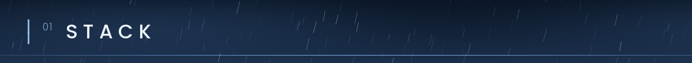
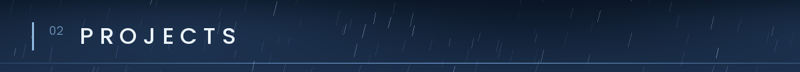
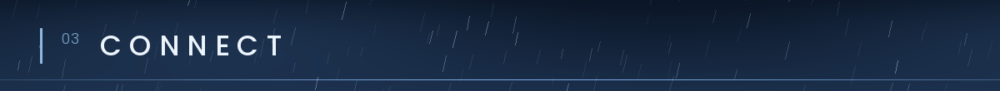

 

  
  

<!-- Keep only the tools you have really used. Add more badges from shields.io the same way. -->

<!-- Replace with your real projects. If you have none yet, delete this whole section. -->

- **Project name**: short description of what it does.

<!-- Replace the links with your own, or delete the lines you don't use. -->

- GitHub: [@your-username](https://github.com/your-username)

 

